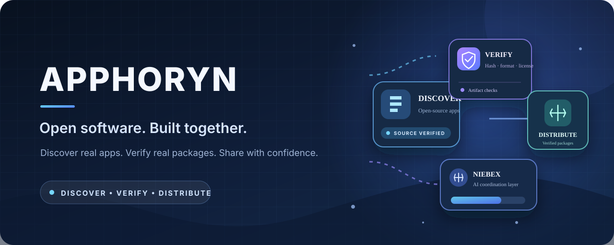
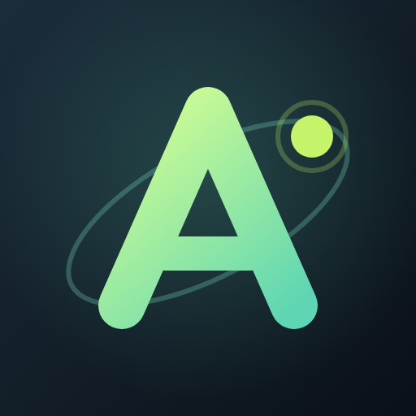
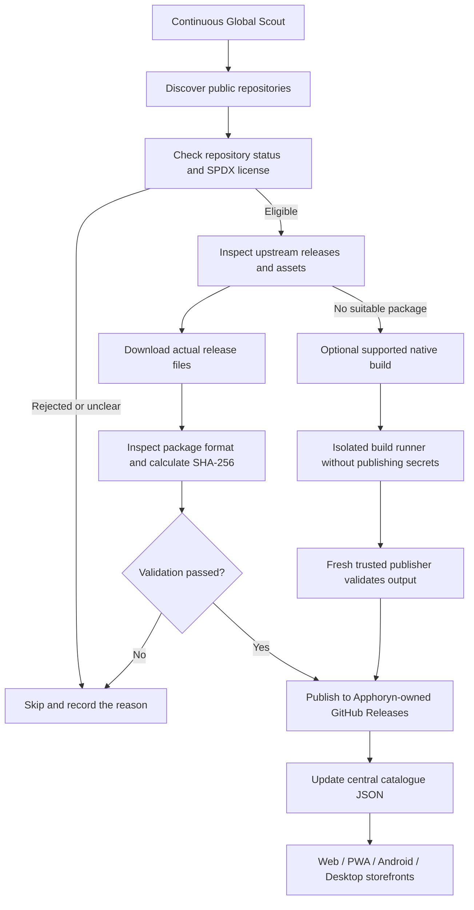
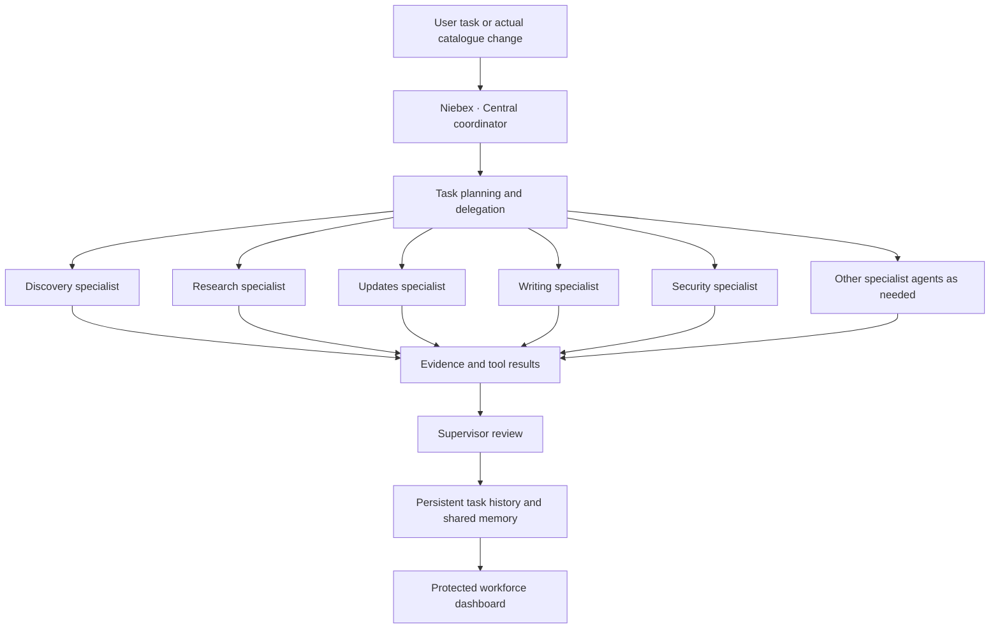

<!-- Apphoryn project README -->
<div align="center">
  
  <p>
    <strong>Discover real open-source apps. Verify real packages. Distribute with confidence.</strong>
  </p>
  <p>
    <a href="https://apphoryn-production.up.railway.app/">Live Store</a> ·
    <a href="https://apphoryn-production.up.railway.app/agents.html">Niebex AI Workforce</a> ·
    <a href="https://github.com/ibra8y3-web/Apphoryn/actions">GitHub Actions</a> ·
    <a href="https://github.com/ibra8y3-web/Apphoryn/releases">Releases</a>
  </p>
  <p>
    <a href="https://github.com/ibra8y3-web/Apphoryn/actions/workflows/ci.yml">
      
    </a>
    <a href="https://github.com/ibra8y3-web/Apphoryn/actions/workflows/harvest.yml">
      
    </a>
    <a href="https://github.com/ibra8y3-web/Apphoryn/actions/workflows/global-scout.yml">
      
    </a>
    <a href="https://github.com/ibra8y3-web/Apphoryn/actions/workflows/build-store-clients.yml">
      
    </a>
    <a href="https://github.com/ibra8y3-web/Apphoryn/blob/main/LICENSE">
      
    </a>
    <a href="https://github.com/ibra8y3-web/Apphoryn/stargazers">
      
    </a>
    <a href="https://github.com/ibra8y3-web/Apphoryn/network/members">
      
    </a>
    <a href="https://github.com/ibra8y3-web/Apphoryn/graphs/contributors">
      
    </a>
    <a href="https://github.com/ibra8y3-web/Apphoryn/commits/main">
      
    </a>
  </p>
</div>

**Apphoryn** is an open-source software discovery, verification, build and distribution platform. It finds real public software, checks whether redistribution is allowed, imports actual upstream release files or uses bounded isolated builds, verifies package metadata and hashes, then publishes approved artifacts through Apphoryn-controlled storage and a shared catalogue.

The repository contains a responsive web/PWA storefront, Android and desktop client projects, a FastAPI backend, automated discovery workflows, package-verification tools, and the Niebex multi-agent AI workforce.

> **No mock inventory:** a repository or search result is only a candidate. Apphoryn marks an app as installable only after a real supported package has passed the applicable validation and publishing steps.

## Contents

- [At a glance](#at-a-glance)
- [Product and platform visuals](#product-and-platform-visuals)
- [How the software store works](#how-the-software-store-works)
- [Discovery and automation schedule](#discovery-and-automation-schedule)
- [Client platforms and build outputs](#client-platforms-and-build-outputs)
- [Niebex AI workforce](#niebex-ai-workforce)
- [AI providers and local models](#ai-providers-and-local-models)
- [Security and supply-chain boundaries](#security-and-supply-chain-boundaries)
- [Privacy-aware analytics](#privacy-aware-analytics)
- [Run Apphoryn locally](#run-apphoryn-locally)
- [Tests and validation](#tests-and-validation)
- [Configuration reference](#configuration-reference)
- [Documentation and community](#documentation-and-community)
- [Current limitations](#current-limitations)
- [License](#license)

## At a glance

| Area | What is in the repository |
|---|---|
| Storefront | Responsive web app and installable PWA with search, categories, saved apps and download centre |
| Languages | English, Arabic (RTL), French, Spanish, German, Portuguese, Turkish and Indonesian; some text can still fall back to English |
| Backend | FastAPI services with SQLite-backed catalogue, artifact records and task services |
| Discovery | GitHub repository and release discovery; additional F-Droid and Flathub catalogue metadata lookup in the AI Workforce |
| Catalogue | Shared manifest at [apps/web/catalog/index.json](apps/web/catalog/index.json) |
| Package integrity | SHA-256 calculation, release digest comparison when provided, package-format inspection and APK signature verification |
| Distribution | Apphoryn-owned GitHub Releases for imported application artifacts |
| Automation | Continuous incremental Global Scout with one-minute import pacing, isolated build workflows and persistent Niebex workers |
| AI | Central coordinator, specialist agents, provider routing, local Ollama/vLLM support and approval-gated tools |

## Product and platform visuals

<div align="center">
  
  <br />
  <sub>Apphoryn application identity · <a href="apps/web/manifest.json">PWA manifest</a></sub>
</div>

The illustration above is project artwork, not a screenshot of a running interface. For the live storefront and current interface, open the [Apphoryn web app](https://apphoryn-production.up.railway.app/).

## How the software store works

The catalogue is generated from real discovery and import results. The upstream project URL is retained for attribution and provenance; when an Apphoryn mirror exists, the storefront download points to the Apphoryn-hosted artifact.



### Discovery, import and verification

1. **Discovery:** Global Scout searches application-focused GitHub categories and incrementally crawls public repositories, resuming from a persistent cursor.
2. **Eligibility:** archived repositories, projects without a usable license declaration, and licenses outside the configured SPDX redistribution allowlist are not automatically mirrored.
3. **Real release assets:** the importer downloads actual upstream release files. A source archive, README link, screenshot or repository URL is not treated as an installable package.
4. **Integrity checks:** Apphoryn calculates SHA-256 locally, compares a supplied upstream digest when available, and inspects each file according to its format. APK verification uses Android `apksigner`.
5. **Publishing:** only accepted artifacts are stored in Apphoryn-owned GitHub Releases and referenced by the generated catalogue.
6. **Build fallback:** supported projects without a suitable release package may be sent to a bounded native build adapter. Third-party source executes on a disposable runner without Apphoryn publishing secrets; a separate publisher runner validates the result again.

The importer understands package families including APK, EXE/PE, MSI/OLE, MSIX/APPX, AppImage/ELF, DEB, RPM, DMG/UDIF, PKG/XAR, JAR and supported portable ELF/Mach-O outputs. Format support does not mean every project can be built for every operating system.

### Discovery and automation schedule

| Automation | Trigger / cadence | Responsibility |
|---|---|---|
| **Apphoryn Scout** | Every hour, on relevant pushes to `main`/`master`, and manual dispatch | Search application-focused GitHub categories, inspect releases, import eligible assets and run bounded build fallbacks |
| **Global Scout** | Long-running worker; restarted by a five-minute recovery schedule | Incremental public-repository crawl, release checks, verified imports paced one start every 60 seconds, and supported isolated builds |
| **Niebex catalogue watcher** | Every 5 minutes by default (configurable, bounded to 1–60 minutes) | Compare the shared catalogue with its saved snapshot and queue a read-only review only for real metadata/version/artifact changes |
| **Storefront refresh** | Every 2 minutes while open, and when the user returns to the app | Refresh the shared catalogue without requiring a full browser restart |
| **Native client builds** | Changes to client/storefront source paths, pull requests for those paths, or manual dispatch | Build the Android and desktop client packages for CI testing |

The separate one-off Harvest workflow remains available from the repository's [Actions page](https://github.com/ibra8y3-web/Apphoryn/actions); automatic imports are owned by Global Scout. GitHub Actions cannot schedule a workflow more frequently than every five minutes, so the five-minute schedule is only a recovery trigger—the long-running worker itself spaces import starts by 60 seconds. Its cursor and retry queue preserve unfinished discovery/import work across runs. A candidate is never published just because a build was dispatched.

## Client platforms and build outputs

| Platform | Current project / CI package target | Important note |
|---|---|---|
| Web | Responsive site and PWA | Installable from supported browsers |
| Android | Gradle application; CI builds a debug APK | The current CI APK is a development/debug build, not a Play Store production release |
| Windows | Electron desktop client; NSIS `.exe` installer | Platform code signing is not configured by the current build workflow |
| Linux | Electron desktop client; AppImage, DEB and RPM | Packages are produced on native Linux CI runners |
| macOS | Electron desktop client; PKG and DMG | Apple signing and notarization are not configured by the current build workflow |

The native-client workflow uploads CI outputs as GitHub Actions artifacts with a **14-day retention period**. These test/build artifacts are separate from the persistent Apphoryn GitHub Releases used to mirror verified third-party application packages. Do not treat an unsigned development build as a production-ready installer.

The desktop installer bridge checks the catalogue SHA-256 before handing a package to the operating system. Installation still follows each platform's native permission, signature and administrator prompts; Apphoryn does not bypass operating-system security controls.

## Niebex AI workforce

Niebex is the central coordinator for Apphoryn's AI workforce. It plans tasks, selects relevant specialist roles, coordinates their work and tracks the evidence and results. The workforce is an additive backend layer: it does not replace the catalogue, Scout importer, package verifier or release publisher.



### What persists and what runs

- Niebex coordinates ten specialist agents; the Supervisor reviews evidence and outcomes.
- The durable task queue, run history, shared memory, schedules, worker heartbeats and model-request telemetry are stored separately from the store catalogue in `storage/agent-workforce.sqlite3`.
- FastAPI starts background workers with the application. The default is two workers; `APPHORYN_AGENT_WORKERS` can be set from 1 to 4.
- Workers remain ready to process queued work and schedules. They do not continuously call language models while idle.
- The workforce autopilot is enabled by default. An administrator's persisted dashboard setting takes precedence over the environment default.
- The admin dashboard is available at `/agents.html`. Its protected API is under `/api/v1/admin/agents` and requires `APPHORYN_ADMIN_TOKEN`. The dashboard does not persist the token in browser storage.

### Catalogue-change reviews are not imports

The Niebex watcher reads the canonical public catalogue, saves a durable snapshot and queues a review only when application metadata, release versions or artifact hashes actually change. Niebex routes that review to relevant specialists and the Supervisor.

Those automatic catalogue reviews are **read-only**: they do not import packages, build software, edit source code or publish releases. The Scout workflows remain responsible for discovery, importing, building and publishing.

### Tools and approvals

The allowlisted workforce tools can perform real repository discovery, repository and release inspection, safe file reads, package validation, approved imports and approved isolated build dispatches. External actions require task-level approval; scheduled tasks do not receive external-action approval automatically.

Code proposals and pull requests have separate gates: the task must permit code changes, `APPHORYN_CODE_WRITES_ENABLED` must be enabled, the repository must be allowed and every modified path must be on the configured allowlist. Direct writes to `main` are not the intended code-change path. Keep these controls disabled unless an administrator explicitly authorizes the work.

The workforce can query F-Droid and Flathub for catalogue metadata. Those results are discovery references, **not verified installation binaries**. Direct F-Droid APK mirroring still needs index/signature-chain verification and a redistribution-license review; Flathub metadata is not a Windows, macOS or Android installer.

## AI providers and local models

The AI router supports local and hosted provider paths, including:

| Provider family | Configuration / safeguard |
|---|---|
| Ollama | Optional local model endpoint via `OLLAMA_BASE_URL` |
| vLLM | Optional OpenAI-compatible endpoint via `VLLM_BASE_URL` |
| Google Gemini | `GEMINI_API_KEY`; free-tier use must be explicitly confirmed |
| Groq | `GROQ_API_KEY`; free-tier use must be explicitly confirmed |
| xAI Grok | `XAI_API_KEY`; metered and disabled by default |
| OpenRouter | `OPENROUTER_API_KEY`; model and paid-traffic policy still apply |
| Cloudflare | `CLOUDFLARE_API_TOKEN` and account ID; disabled by default |
| Comet | `COMET_API_KEY`; credit-based access requires explicit policy configuration |

The safe baseline is free-only mode, with paid requests disabled. xAI and Cloudflare are not assumed to be free. Gemini/Groq free-tier confirmation is a configuration assertion, not a live billing-plan or remaining-quota check. A configured API key alone does not prove that a provider is enabled, reachable, healthy or within a free quota.

For local inference, the optional Docker Compose `local-ai` profile runs Ollama on a private internal network. vLLM can be pointed at a loopback or private service URL. Model discovery and routing use the available local/provider configuration and observed request outcomes; there is no claim of universal model ranking or guaranteed provider availability.

## Security and supply-chain boundaries

- **License policy:** automatic redistribution is gated by repository state and the configured SPDX allowlist. License checks are a technical gate, not legal advice; upstream notices and source-offer obligations still apply.
- **Untrusted source code:** third-party source builds run on disposable GitHub-hosted runners without Apphoryn publishing credentials. The trusted publishing stage is separate and validates output as data.
- **Artifact integrity:** Apphoryn computes SHA-256 for stored artifacts and records upstream digest comparison separately when the upstream release supplies one.
- **APK checks:** APK signature verification confirms that the package has a valid signature. It does not prove the publisher's identity or that the application is free from malware.
- **Security compute:** `.github/workflows/agent-compute.yml` can run Semgrep, Trivy, OSV-Scanner, Syft (CycloneDX SBOM) and Gitleaks on an explicitly selected public repository. This is a bounded scan workflow, not a guarantee of software safety; it does not execute the target repository's build scripts or Actions workflows.
- **Credentials:** keep GitHub, artifact-ingest and AI credentials server-side or in the appropriate GitHub Actions secrets. Never place secrets in browser JavaScript, public catalog JSON or third-party source-build steps.
- **Code changes:** GitHub compute and code-write capabilities are disabled by default in `.env.example`. Enabling them requires deliberate configuration and separate task approval.
- **Platform trust:** Windows signing, macOS notarization, comprehensive malware scanning, signed provenance attestations and full SBOM publication are not yet universal gates for every imported package.

The current implementation favors explicit rejection over pretending an unsupported or unverifiable package is safe or installable.

## Privacy-aware analytics

The storefront can record catalogue/app-detail views, hashed search queries, favorite changes, verified-artifact download requests and downloads completed through the Apphoryn backend stream.

- Raw search text is SHA-256 hashed before storage.
- The event ledger writes to a local SQLite outbox first.
- Optional bounded replication is available to PostgreSQL-compatible Neon/Supabase or Cloudflare D1.
- The ledger does not store client IP addresses, cookies, authentication headers or raw search text.
- A browser-reported request is not counted as a completed download; the backend only records completion when its own artifact stream finishes.
- Pending events remain locally queued when a remote database is unavailable and can be retried later.

Configure only one remote analytics replica when needed. Keep database credentials separate from AI inference credentials.

## Run Apphoryn locally

### Requirements

- Python 3.11 or newer
- Git
- Node.js only when working on or testing the JavaScript/desktop client
- Docker Compose only for the containerized deployment or optional local-model profile

### Backend and storefront

```bash
git clone https://github.com/ibra8y3-web/Apphoryn.git
cd Apphoryn

python -m venv .venv

# macOS / Linux
source .venv/bin/activate

# Windows PowerShell
# .venv\Scripts\Activate.ps1

python -m pip install -r requirements.txt
cp .env.example .env
```

Before exposing the service, set strong, different values for `APPHORYN_ADMIN_TOKEN` and `APPHORYN_INGEST_TOKEN` in `.env`. Keep the default `APPHORYN_BIND=127.0.0.1` for local use.

```bash
uvicorn app.main:app --host 127.0.0.1 --port 8000
```

Open [http://127.0.0.1:8000](http://127.0.0.1:8000). Local artifacts are stored under `storage/artifacts/`; preserve the `storage` volume when upgrading so the catalogue, workforce state and local records remain available.

### Docker Compose

```bash
cp .env.example .env
# Set APPHORYN_ADMIN_TOKEN and APPHORYN_INGEST_TOKEN before starting.
docker compose up -d --build
```

For optional local Ollama inference, configure `OLLAMA_BASE_URL=http://ollama:11434` in `.env`, then run:

```bash
docker compose --profile local-ai up -d
```

The Docker volume `apphoryn_data` retains application data; `ollama_models` retains downloaded model weights. Back up both volumes. The application runs as a non-root user. Before remote exposure, use an authenticated TLS reverse proxy and a firewall.

### Offline boundary

When the host remains powered on but Internet connectivity is lost, the local UI/API, SQLite queue, shared memory, analytics capture and already-downloaded local models can continue. GitHub Actions, upstream discovery, hosted AI providers and remote database replication require connectivity. A powered-off device cannot run background workers.

## Tests and validation

Run the repository checks from the project root:

```bash
python -m compileall -q app scripts tests
python -m unittest discover -s tests -v
node --check apps/web/app.js
node --check apps/web/agents.js
node --check apps/web/sw.js
```

The CI workflow also checks CLI entry points, JSON manifests and selected workflow/configuration files. Tests cover API behavior, catalogue logic, agent scheduling, artifact storage and validation, provider routing, analytics, download handling and Scout/build helpers.

Unit tests do not replace integration verification of a particular upstream release. The actual Scout workflow performs the external discovery/import work; a candidate is not considered successfully mirrored until the workflow and artifact records confirm it.

## Configuration reference

Copy `.env.example` and configure only the features you intend to run. Common settings:

| Variable | Purpose | Safe/default behavior |
|---|---|---|
| `APPHORYN_ADMIN_TOKEN` | Protect admin APIs and workforce dashboard | Set a long random secret |
| `APPHORYN_INGEST_TOKEN` | Authenticate artifact ingestion | Use a different secret from the admin token |
| `APPHORYN_AGENT_DATABASE` | Persistent workforce SQLite database | `./storage/agent-workforce.sqlite3` |
| `APPHORYN_AGENT_WORKERS` | Background worker count | `2`, configurable from 1 to 4 |
| `APPHORYN_AGENT_AUTOPILOT_ENABLED` | Default for workforce autopilot | `true`; saved admin setting takes precedence |
| `APPHORYN_CATALOG_POLL_SECONDS` | Niebex shared-catalog polling interval | `300`, clamped to 60–3600 seconds |
| `APPHORYN_IMPORT_INTERVAL_SECONDS` | Minimum interval between automatic app import starts | `60` seconds; first import starts immediately |
| `APPHORYN_TRANSLATION_INTERVAL_SECONDS` | Minimum interval between backfill translation requests | `1` second; stored source descriptions are preserved |
| `APPHORYN_GITHUB_COMPUTE_ENABLED` | Enable the GitHub-hosted security compute path | `false` |
| `APPHORYN_CODE_WRITES_ENABLED` | Permit gated source-code PR actions | `false` |
| `APPHORYN_AI_FREE_ONLY` | Prefer free-only provider policy | `true` |
| `APPHORYN_AI_ALLOW_PAID_REQUESTS` | Allow explicitly authorized paid model traffic | `false` |
| `APPHORYN_AI_ENABLE_XAI` | Enable xAI Grok API routing | `false` |
| `APPHORYN_AI_ENABLE_CLOUDFLARE` | Enable Cloudflare AI routing | `false` |
| `APPHORYN_ANALYTICS_POSTGRES_DSN` | Optional PostgreSQL analytics replica | Empty unless configured |
| `CLOUDFLARE_D1_DATABASE_ID` and `CLOUDFLARE_D1_API_TOKEN` | Optional Cloudflare D1 analytics replica | Empty unless configured |

The full variable list and comments are maintained in [.env.example](.env.example). Never commit real secrets.

## Documentation and community

- [Architecture](docs/ARCHITECTURE.md)
- [Autonomous operations and catalogue watcher](docs/AUTONOMOUS_OPERATIONS.md)
- [AI provider routing](docs/AI_ROUTING.md)
- [Security policy](docs/SECURITY.md) · [Repository security policy](SECURITY.md)
- [Native installation behavior](docs/NATIVE_INSTALL.md)
- [Supported source-build adapters](docs/SUPPORTED_BUILDS.md)
- [Deployment guide](deploy/README.md)
- [Contributing guide](CONTRIBUTING.md)
- [Code of conduct](CODE_OF_CONDUCT.md)
- [Open issues](https://github.com/ibra8y3-web/Apphoryn/issues)
- [Discussions and pull requests](https://github.com/ibra8y3-web/Apphoryn/pulls)
- [Contributor activity graph](https://github.com/ibra8y3-web/Apphoryn/graphs/contributors)
- [Repository traffic and insights](https://github.com/ibra8y3-web/Apphoryn/graphs/traffic)

### Contributors

Thanks to everyone who contributes code, reviews, documentation, testing and ideas. This contributor image is generated from the repository's public GitHub contributor data and updates independently of this README.

<div align="center">
  <a href="https://github.com/ibra8y3-web/Apphoryn/graphs/contributors">
    
  </a>
  <br />
  <sub>Contributor image by <a href="https://contrib.rocks/">contrib.rocks</a> · <a href="https://github.com/ibra8y3-web/Apphoryn/graphs/contributors">View the full GitHub contribution graph</a></sub>
</div>

## Current limitations

- Build adapters support defined project patterns; Apphoryn cannot compile every public repository or guarantee that a project has builds for every platform.
- F-Droid and Flathub lookup currently provides discovery/catalogue metadata, not a blanket verified-binary import path.
- A matching SHA-256 proves byte consistency with the compared digest, not that software is benign.
- APK signature verification does not prove publisher identity or malware absence.
- Current CI Android output is a debug APK. Desktop code-signing and macOS notarization are not configured by the current client-build workflow.
- Native client CI artifacts expire after 14 days unless separately released or retained. Imported third-party application binaries published to Apphoryn Releases are a different storage path.
- Large-scale global distribution will eventually need dedicated object storage/CDN, database-backed catalogue indexing, quotas, moderation and retention policies.
- A hosted AI provider may be unavailable, rate-limited, disabled by policy or paid. Apphoryn does not invent quota, billing or provider-health information.

## License

The Apphoryn platform source in this repository is released under the [MIT License](LICENSE). Imported applications and their binaries remain subject to their respective upstream licenses, notices and redistribution obligations.

---

<div align="center">
  <sub>Built in the open · <a href="https://github.com/ibra8y3-web/Apphoryn">Apphoryn on GitHub</a></sub>
</div>
